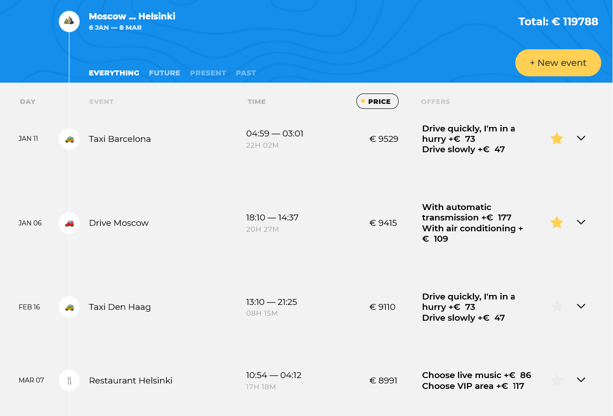

# Большое путешествие

Учебный проект [HTML Academy](https://htmlacademy.ru): одностраничное приложение для планирования маршрута поездки. Создавайте точки маршрута, считайте стоимость путешествия и смотрите информацию о местах назначения.

[Живая версия](https://anastasiiaxx.github.io/2402573-big-trip-2/)



## Что реализовано

**Точки маршрута**
- Список точек маршрута, загружаемых с сервера: тип, время и длительность, стоимость, дополнительные опции.
- Добавление точки в избранное.
- Создание новой точки маршрута, редактирование существующей точки, удаление точки.

**Фильтры и сортировка**
- Фильтры Everything, Future, Present, Past, сообщения-заглушки для пустых списков.
- Сортировка по дате, длительности и стоимости.

**Взаимодействие с сервером**
- Загрузка, создание, изменение и удаление точек через API.
- Индикация загрузки, блокировка интерфейса на время запроса.

**Дополнительно**
- Название маршрута, даты и общая стоимость в шапке пересчитываются при изменении данных.

Вёрстка выполнена по готовому шаблону курса.

## Архитектура

Паттерн MVP (Model — View — Presenter), приложение разбито на модели, представления и презентеры. Чистый JavaScript, без фреймворков.

## Стек

JavaScript, Webpack, Babel, ESLint, [dayjs](https://day.js.org/), [flatpickr](https://flatpickr.js.org/), [he](https://github.com/mathiasbynens/he).

## Как запустить

Требуется Node.js 20.

```bash
git clone https://github.com/AnastasiiaXX/2402573-big-trip-2.git
cd 2402573-big-trip-2
npm install
npm start
```

Проект откроется в браузере. Данные загружаются с сервера HTML Academy, нужен доступ в интернет.

Сборка для production: `npm run build`.
